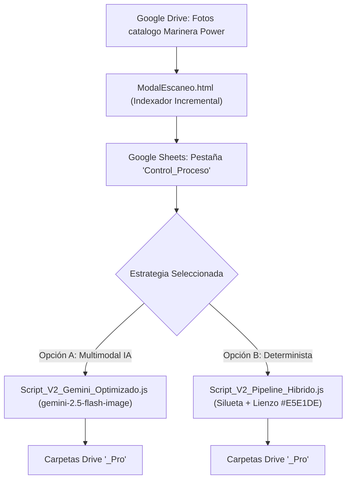

# ☁️ Arquitectura Técnica de Google Apps Script: Marinera Power

Este documento detalla la lógica de los scripts desarrollados para automatizar la profesionalización de imágenes directamente en Google Drive y Google Sheets.

---

## 1. Evolución Histórica de los Scripts

### Versión Inicial (Septiembre 2026 - `scriptmarinerapower.txt`)
* **Problema:** Procesamiento lineal sin control estricto de cuotas. El script procesaba imágenes una a una pero caía en el límite de ejecución de Google Apps Script (máximo 6 minutos para cuentas Workspace, 4 minutos efectivos para evitar timeouts duros).
* **Deficiencia:** Al fallar un lote, el script volvía a procesar desde el inicio, duplicando llamadas a la API de Gemini y cobros innecesarios. Las fotos en formato HEIC tomadas con iPhone perdían nitidez al convertirse.

### Versión Optimizada V2 (Octubre 2026 - Repositorio `src/`)
Se implementó una arquitectura bifurcada en dos opciones técnicas:

---

## 2. Los Scripts en Producción

### A. Opción 1: Gemini 2.5 Flash Image Multimodal (`src/Script_V2_Gemini_Optimizado.js`)
* **Modelo IA:** `gemini-2.5-flash-image` con parámetro `responseModalities: ["IMAGE"]`.
* **Mecanismos de Protección FinOps & Throttling:**
  * **Pausa obligatoria de 12 segundos (`12000 ms`):** Evita superar el límite de tasa de 10 peticiones/minuto de Tier 1.
  * **Detención preventiva a los 4 minutos (`240000 ms`):** Detiene la ejecución de forma limpia antes de que Google Apps Script aborte el proceso forzosamente, guardando el estado actual.
  * **Límite de 1 reintento (`MAX_REINTENTOS = 1`):** Si una imagen falla una vez, se marca como `ERROR_REINTENTO`; si falla dos veces, se bloquea (`BLOQUEADO`) y no se vuelve a intentar, erradicando costos fantasmas.
* **Manejo de Fotos HEIC de iPhone:**
  * Detecta el MIME type `image/heic` / `image/heif` y extrae el thumbnail de alta resolución en memoria generado por Google Drive (`=s2048`) sin modificar el archivo original en la nube.

### B. Opción 2: Pipeline Híbrido Determinista (`src/Script_V2_Pipeline_Hibrido.js`)
* **Lógica:** Segmenta la silueta del sujeto (Background Removal) y compone sobre un lienzo plano `#E5E1DE`.
* **Ventaja:** Cero alucinación. No hay intervención generativa sobre la prenda ni las joyas, asegurando 100% de correspondencia legal con el producto entregado al comprador.

### C. Interfaz de Escaneo (`src/ModalEscaneo.html`)
* Ventana modal inyectada en Google Sheets a través del menú superior `🎨 Marinera Studio Pro > Escanear Carpeta`.
* Permite ingresar cualquier enlace o ID de carpeta de Google Drive.
* Muestra un desglose en tiempo real de archivos encontrados (`JPG`, `PNG`, `HEIC`) antes de ejecutar el procesamiento e inserta solo los archivos nuevos en `Control_Proceso` sin sobreescribir el historial.

---

## 3. Control de Versiones con Git y Clasp

Para evitar pérdidas de código al editar en el editor web de Google Apps Script:
1. **Repositorio Local Git:** Todos los scripts residen en `src/` dentro de este proyecto.
2. **Uso de Clasp (Google Command Line Apps Script Projects):**
   * Se recomienda vincular el script ID de Google Sheets mediante `.clasp.json`.
   * Comandos de sincronización:
     * `clasp pull`: Descarga las últimas funciones desde Google Sheets.
     * `clasp push`: Sube las versiones auditadas locales a la nube.
