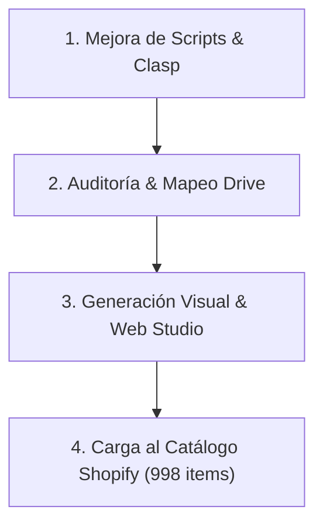

# 🚀 Roadmap Técnico & Próximas Acciones: Marinera Power

Este documento define el plan de trabajo para el perfeccionamiento de los scripts, la generación masiva de imágenes y la integración con el catálogo digital.

---

## 📋 Líneas de Trabajo Activas

### 1. Perfeccionamiento de Scripts (Apps Script & Local)
* [ ] **Configuración de Clasp:** Configurar `.clasp.json` en `Cliente Marinera Power/src` para subir y descargar cambios en Google Sheets con comandos directos (`clasp push`, `clasp pull`).
* [ ] **Ajuste de Prompts en Apps Script:** Refinar el prompt en `Script_V2_Gemini_Optimizado.js` para diferenciar automáticamente si la imagen es una prenda aislada sobre maniquí o una persona real en pose de baile.
* [ ] **Pruebas de Estrategia B (Pipeline Híbrido):** Evaluar el script `Script_V2_Pipeline_Hibrido.js` en una muestra de 10 productos complejos (aretes de filigrana con fondo transparente) para contrastar contra la Opción A.

### 2. Auditoría y Sincronización de Google Drive
* [ ] **Crawl Maestro de Carpetas:** Ejecutar un escaneo completo de la carpeta madre `1SERKR606LbQEYkgLTgDB0f-pUoMhvNz4` para verificar cuántos de los 998 productos del catálogo ya cuentan con fotos cargadas en sus carpetas respectivas.
* [ ] **Verificación de Salidas `_Pro`:** Correlacionar los archivos existentes en las carpetas `_Pro` con las filas de la hoja `Control_Proceso` para identificar inconsistencias o archivos faltantes.

### 3. Producción Visual en Estudio Web Canvas (`app/index.html`)
* [ ] **Ampliación de Presets:** Incorporar selector de brillo y saturación específicos para telas satinadas.
* [ ] **Exportación en Lote:** Añadir función de exportación simultánea en los 3 formatos (1:1 Feed, 4:5 Retrato, 9:16 Story) con un solo clic.
* [ ] **Rediseño del Tablero de Control (`output/catalogo_marinera_power_oficial.html`):**
  * Reconstruir como **Dashboard de Control de Calidad y Procesamiento** conectado a Google Sheets (`Registro_Imagenes_Creadas` - GID: `779499709`).
  * **Métricas clave en tiempo real:** Total procesadas, aprobadas (`APROBADO_CATALOGO`), fallidas (`ERROR_TEST_PROMPT`) y reprocesadas.
  * **Carga de imágenes vía CDN/Drive:** Renderizar miniaturas usando enlaces directos `https://lh3.googleusercontent.com/d/<ID>` en vez de rutas locales relativas rotas.
  * **Vista comparativa:** Original vs. Versión PRO lado a lado con botón de auditoría.

### 4. Integración con el Catálogo de la Tienda
* [ ] **Cruce con Archivo Maestro de Productos:** Vincular las fotos procesadas con los identificadores del archivo `Catálogo MarineraPower FULL.xlsx` para facilitar la importación en Shopify.
