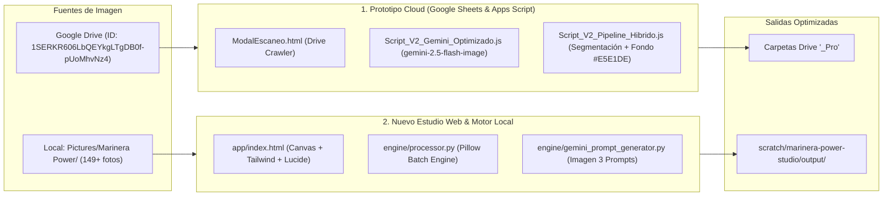

# 💃 Contexto Maestro & Arquitectura Unificada: Marinera Power

> **Cliente / Marca:** Marinera Power (Gianina & Carlos Carbajal)  
> **Área:** Producción Visual, Catálogo E-Commerce & Automatización de Imágenes  
> **Ruta Local del Proyecto:** `C:\Users\LENOVO\Documents\Carlitos\IA\Antigravity\Profesionalización de catálogo\Cliente Marinera Power\`  
> **Subagente Especializado Registrado:** `marinera-image-agent`  
> **Skill Global Registrado:** `marinera-power-orchestrator`

---

## 1. Fuentes de Datos y Carpetas de Trabajo

### A. Entorno Cloud (Google Drive & Google Sheets)
* **Carpeta Madre de Fotos en Google Drive:**
  * **ID:** `1SERKR606LbQEYkgLTgDB0f-pUoMhvNz4`
  * **Nombre en Drive:** `Fotos catalogo Marinera Power`
* **Carpetas de Salida Generadas:** Subcarpetas equivalentes con sufijo `_Pro` (ej. `Fotos catalogo Marinera Power_Pro`).
* **Hoja de Cálculo de Control:** Pestaña `Control_Proceso` que audita estados (`NUEVO`, `EN_PROCESO`, `COMPLETADO`, `ERROR_REINTENTO`, `BLOQUEADO`), enlaces a originales y salidas procesadas.

### B. Entorno Local (Windows)
* **Banco de Fotos Originales y Editadas:**
  `C:\Users\LENOVO\Pictures\Marinera Power\`
  * `#0044EE turquesa con cinta blanca\` (Vestidos oficiales de concurso)
  * `#353C51 Azul marino\` (Trajes señoriales y capturas de catálogo)
  * `fotos creadas\` (149+ archivos entre aretes de filigrana, escapularios, mantos de pava y de leche, tocados con pedrería, fajas de hilo y tomas en alta resolución)
* **Carpeta de Salida Local PRO:**
  `C:\Users\LENOVO\.gemini\antigravity\scratch\marinera-power-studio\output\`

---

## 2. Los Dos Motores del Ecosistema

---

## 3. Desglose de Componentes Técnicos

### 1. El Prototipo Apps Script (`prototype/`)
* **`Script_V2_Gemini_Optimizado.js`**: Integración con Google AI Studio mediante `gemini-2.5-flash-image`. Aplica un prompt anti-alucinaciones con temperatura ultrabaja (0.1) y reemplaza fondos por el gris de estudio `#E5E1DE`. Controla throttling (pausa de 12 segundos) y previene bloqueos de cuota.
* **`Script_V2_Pipeline_Hibrido.js`**: Segmentación pura de prendas/modelos y montado sobre lienzo neutro `#E5E1DE`. 0% alucinaciones: las joyas de filigrana y los bordados a mano se preservan idénticos píxel por píxel.
* **`ModalEscaneo.html`**: Diálogo modal dentro de Google Sheets para pegar enlaces o IDs de Drive, con desglose de extensiones (JPG, PNG, HEIC de iPhone tratado con `=s2048`) e indexación no destructiva.
* **`docs/Mapeo_Maestro_Fotos_Originales_vs_Pro.md`**: Bitácora de correlación para auditar que cada foto original tenga su respectiva versión PRO en Drive.

### 2. La Nueva Versión Web (`app/`)
* **`index.html`**: Estudio interactivo visual que se ejecuta de forma nativa en el navegador mediante HTML5 Canvas y Tailwind CSS.
  * Drag & Drop desde `Pictures/Marinera Power`.
  * Presets de 1 clic: `E-Commerce 1:1`, `Casona Editorial 4:5`, `Filigrana & Joyas 1:1`, `Story / Reel 9:16`.
  * Filtros de contraste, brillo, saturación textil, calidez dorada y nitidez de relieve.
  * Incrustación del sello oficial de marca `MARINERA POWER | OFICIAL`.
  * Generador de Prompts para Gemini Imagen 3 con botón de copia rápida al portapapeles.
  * Descarga directa en alta definición sin compresión destructiva.

### 3. Motor Python (`engine/`)
* **`processor.py`**: Procesamiento por lotes en terminal con soporte para recorte inteligente a relación de aspecto y color grading.
* **`gemini_prompt_generator.py`**: Generador de super-prompts enriquecidos con vocabulario técnico peruano (filigrana de Catacaos en plata 925 con baño de oro 24k, escapulario devocional, pañuelo calado de lino, falda de 3 tiempos, casona virreinal de Trujillo).

---

## 4. Reglas Innegociables de Calidad & Identidad (Brand Book)

1. **Preservación Total del Producto:** Prohibido redibujar o deformar bordados tradicionales, calados de mantos, pañuelos o joyas de filigrana.
2. **Cero Distorsión Facial:** Los rostros de los bailarines y modelos no se modifican ni se alucinan.
3. **Paleta Oficial:**
   * **Turquesa Libertad:** `#0044EE`
   * **Azul Marino Señorial:** `#353C51`
   * **Oro Filigrana:** `#D4AF37`
   * **Rojo Pasión Norteña:** `#A31D1D`
   * **Blanco Lino Perla:** `#FDFBF7`
   * **Gris Estudio E-commerce:** `#E5E1DE`

---

## 5. Quality Gates Deterministas & Protocolo de Veto (Dictamen Carlos Carbajal 2026)

* **Normativa Vigente:** Especificación completa en `config/quality_gates_catalogo.md`.
* **Regla de Escala 1:1:** Prohibición absoluta de Zoom-Out o encogimiento de la modelo (Caso 2 `34a63e97`). Tolerancia de variación de altura $< 8\%$.
* **Delta Cromático Periférico:** Fondo `#E5E1DE` (RGB 229, 225, 222) controlado en las 4 esquinas con $\Delta E \le 18.0$. Prohibición estricta de virajes a marrón u oliva.
* **Suelo Impoluto (*Pristine Floor*):** Prohibición de manchas de tierra o lodo bajo los pies de la modelo. Sombra de contacto transparente y sutil.
* **Fail-Safe Estricto:** Todo evaluador de visión o matemático rechaza por defecto (`score: 30, aprobada: False`) ante cualquier incertidumbre o error.
* **Bucle Masivo:** Sellado y vetado hasta validación 5/5 en Canary Test V2.
