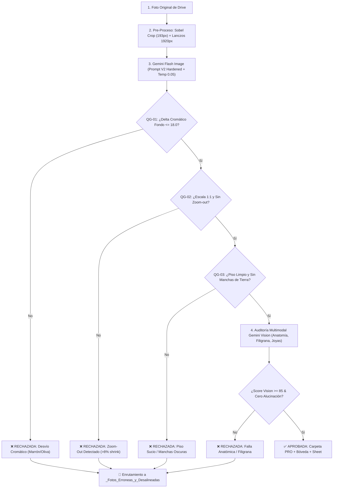

# 🏛️ MARINERA POWER: Matriz Oficial de Quality Gates Deterministas & Parámetros de Diseño

> **Documento:** Reglas Oficiales de Control de Calidad E-Commerce (Catálogo General 2026)  
> **Fecha de Emisión:** 05 de Noviembre de 2026  
> **Autor / Auditor:** Carlos Carbajal Linán (Red Team Quality Auditor)  
> **Estado:** NORMATIVA VIGENTE - APLICACIÓN OBLIGATORIA PREVIA A BUCLE MASIVO

---

## 1. Filosofía de Arquitectura: "El Determinismo Manda, la IA Complementa"

En pipelines generativos de moda y joyería de alta gama, confiar únicamente en evaluadores LLM provoca complacencia ("hallucination creep") y desvíos sutiles acumulativos.
La regla de oro del pipeline de Marinera Power es:
**Cualquier anomalía matemática, cromática, espacial o anatómica debe ser rechazada en Python con costo $0 y latencia < 50ms antes de llamar a modelos de visión o escribir en Google Drive.**

---

## 2. Matriz de Quality Gates Deterministas

| ID Gate | Nombre del Control | Naturaleza / Algoritmo | Umbral Crítico (Fail Threshold) | Justificación Técnica | Objetivo de Negocio | Riesgo Mitigado |
| :--- | :--- | :--- | :--- | :--- | :--- | :--- |
| **QG-01** | **Delta Cromático Periférico** | Medición Euclidiana RGB en 4 esquinas vs `(229, 225, 222)` | $\Delta E > 18.0$ en esquinas exteriores | Los modelos de difusión sufren *ambient spill* y viran el fondo a marrones u olivas. | Erradicar el "efecto ajedrez" en la grilla del catálogo. | Inconsistencia de marca y fondos disparatados. |
| **QG-02** | **Caja Delimitadora & Escala 1:1** | Detección de Bounding Box y Relación de Aspecto (Otsu / Contornos) | Variación de altura de sujeto $> 8\%$ o $\Delta \text{Aspect Ratio} > 0.10$ | El modelo tiende a hacer *zoom-out* encogiendo al sujeto para meter ciclorama ficticio. | Garantizar que el cliente aprecie detalles de la prenda/joya en primer plano. | Pérdida de resolución de producto y tomas lejanas ilegibles. |
| **QG-03** | **Desplazamiento y Centro de Masa** | Diferencia de centroides del sujeto $(\Delta C_x, \Delta C_y)$ | Desplazamiento $> 5\%$ del ancho o alto de la imagen | La IA no debe mover a la modelo hacia los lados ni generar composiciones desbalanceadas. | Mantener centrado perfecto y balance visual en el feed 1:1. | Desalineación de catálogo y composiciones asimétricas. |
| **QG-04** | **Fidelidad Facial y Anti-Alucinación** | Detección de rostro (OpenCV Haar/DNN) y SSIM en parche facial | Si existe rostro en Original: parches deben tener $\text{SSIM} < 0.82$ o distorsión de facciones | Gemini Image tiende a "re-imaginar" rostros de bailarinas o alterar expresiones nativas. | Respetar la identidad de la bailarina y profesionalismo editorial. | Rostros deformes, expresiones bizarras o sustitución facial. |
| **QG-05** | **Índice de Suciedad y Halos de Piso** | Segmentación de luminosidad en el 15% inferior de la imagen | Píxeles con luminosidad $< 140$ fuera del contorno de pies | La oclusión ambiental de Gemini simula barro/tierra en vez de sombras de estudio. | Mostrar un piso de ciclorama impoluto con sombra de contacto transparente. | Apariencia de estudio sucio o tomas en piso deteriorado. |
| **QG-06** | **Integridad de Parche de Sujeto** | Resta absoluta de imagen masked $|Original - PRO|$ en prendas | Desviación $> 20\%$ en textura de filigrana o bordado | No se permite alterar el diseño artesanal del vestido ni inventar bordados nuevos. | Fidelidad 100% de la prenda vendida en la tienda online. | Reclamos de clientes por prendas que no coinciden con la foto. |

---

## 3. Especificación Técnica de los Parámetros de Diseño

### A. Fondo de Estudio E-Commerce
* **Código Hexadecimal:** `#E5E1DE`
* **Vector RGB Exacto:** `(229, 225, 222)`
* **Tolerancia Máxima ($\Delta E$):** 15.0 puntos en espacio RGB euclidiano.
* **Prohibición Expresa:** Cero degradados, cero sombras de esquinas de habitaciones domésticas, cero viñeteos oscuros.

### B. Proporciones y Escala (Escala 1:1 Inmutable)
* **Regla de Encuadre:** Si la toma original es de cuerpo entero, se mantiene cuerpo entero; si es plano medio / torso, se mantiene plano medio; si es macro de arete, se mantiene macro.
* **Prohibición de Outpainting:** Bajo ninguna circunstancia el modelo debe inventar piernas, pies o vestidos que no existían en el encuadre original.
* **Prohibición de Zoom-Out:** La modelo no puede ser empequeñecida para simular un gran salón de baile.

### C. Suelo y Sombras de Contacto
* **Tipo de Sombra:** Sombra de contacto suave, difusa y transparente inmediatamente bajo la suela del calzado o los pies descalzos.
* **Prohibición:** Prohibido halos oscuros continuos, manchas negras circulares o textura de piso sucio.

---

## 4. Flujo de Ejecución en Colab y Quality Gates Binarios

